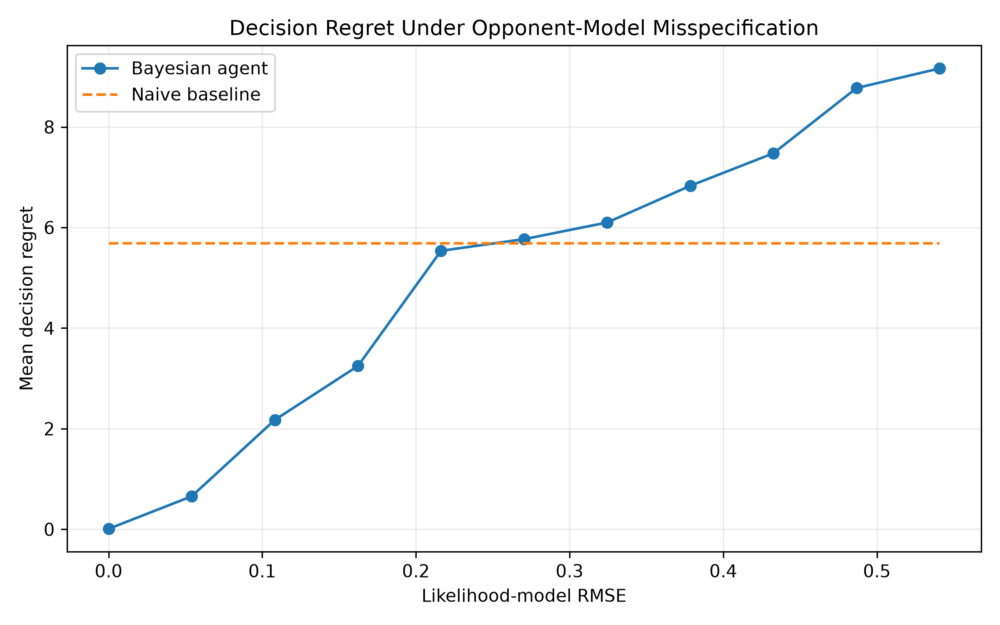
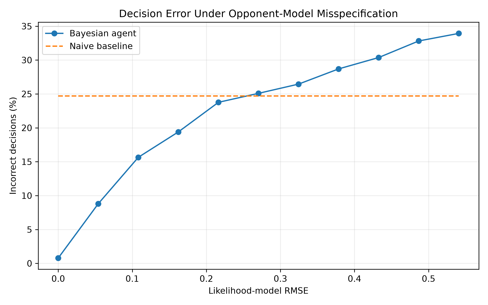
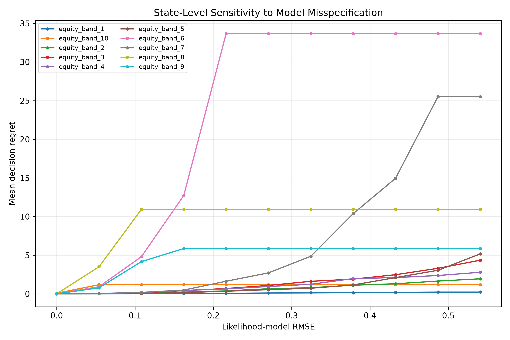

# BayesHoldem

**A Bayesian decision engine for Texas Hold'em under imperfect information.**

BayesHoldem is a from-scratch Python implementation of a probabilistic poker decision system. It combines exact combinatorial enumeration, Monte Carlo simulation, Bayesian opponent modelling, and expected-value decision theory to investigate how behavioural information can improve — or harm — decisions under uncertainty.

The central research question is:

> **How robust is Bayesian decision-making to errors in the underlying opponent model, and when does using an inaccurate model become worse than ignoring behavioural information altogether?**

The project uses Texas Hold'em as a controlled imperfect-information environment in which hidden states, observations, probabilities and decision payoffs can all be explicitly modelled and validated.

---

## Key Results

In the final controlled experiment, BayesHoldem evaluated:

- **10** decision-relevant flop states
- **11** levels of opponent-model misspecification
- **100,000** call/fold decisions per state and misspecification level
- **11,000,000 total decision evaluations**
- exact Bayesian enumeration as the ground-truth conditional equity
- a 50,000-simulation Bayesian estimator for the decision-making agent

Across the selected states:

- A correctly specified Bayesian model reduced **mean decision regret by approximately 99.85%** relative to an action-agnostic baseline.
- Decision error fell by approximately **96.8%** relative to the baseline.
- Performance deteriorated systematically as the likelihood model became increasingly misspecified.
- Bayesian mean regret crossed the naive baseline at approximately **α ≈ 0.46** under interpolation between the measured α = 0.4 and α = 0.5 points.
- A fully inverted behavioural model produced approximately **61% greater mean regret** than ignoring the behavioural signal entirely.

These results apply to the controlled opponent model and experimental framework used here; they are not estimates of real-world poker performance.

---

## Architecture

BayesHoldem separates poker mechanics, probabilistic inference, opponent modelling and decision-making into independent modules:

```text
Cards / Game State
        │
        ▼
┌───────────────────┐
│   Hand Evaluator  │
└─────────┬─────────┘
          │
          ▼
┌───────────────────┐
│   Equity Engine   │
│ Exact + Monte     │
│ Carlo             │
└─────────┬─────────┘
          │
          │       Opponent action
          │            BET
          │             │
          │             ▼
          │      ┌──────────────┐
          │      │ Bayesian     │
          │      │ Update       │
          │      └──────┬───────┘
          │             │
          └──────┬──────┘
                 ▼
        Conditional Equity
                 │
                 ▼
        Expected-Value Model
                 │
                 ▼
             CALL / FOLD
```

The current repository is divided into:

```text
cards.py
    Card representation and deck construction

evaluator.py
    Poker hand evaluation and comparison

equity.py
    Exact enumeration and Monte Carlo equity engines

opponent_model.py
    Hand-strength priors and Bayesian belief updates

decision.py
    Expected-value calculations and CALL/FOLD decisions

experiments.py
    Model-misspecification experiments and evaluation

plot_results.py
    Analysis and result visualisation

main.py
    Reproducible experiment runner
```

---

## 1. Poker Hand Evaluator

The base layer determines the winner between two Texas Hold'em hands.

Cards are represented as dictionaries:

```python
{
    "rank": "A",
    "suit": "spades"
}
```

The evaluator supports the complete standard hand hierarchy:

```text
High Card
Pair
Two Pair
Three of a Kind
Straight
Flush
Full House
Four of a Kind
Straight Flush
```

Tie-breaking information such as pair rank, kickers and straight high cards is retained so that two evaluated hands can be compared deterministically.

This evaluator forms the foundation for both exact enumeration and Monte Carlo simulation.

---

## 2. Exact Equity

For incomplete game states, BayesHoldem can calculate equity by systematically enumerating possible hidden opponent holdings and future community cards.

Equity is defined as:

$$
E = P(\text{win}) + \frac{1}{2}P(\text{tie})
$$

For a flop state, the engine can enumerate every legal combination of:

1. the opponent's two hidden cards;
2. the turn;
3. the river.

Exact enumeration provides a ground-truth benchmark against which approximate inference methods can be validated.

---

## 3. Monte Carlo Equity

Exhaustive enumeration becomes increasingly expensive as the number of unknown cards grows.

BayesHoldem therefore also implements Monte Carlo equity estimation.

Each simulation:

1. samples a legal opponent holding;
2. samples the remaining community cards;
3. evaluates both completed hands;
4. records a win, loss or tie.

After $N$ simulations:

$$
\hat{E}_N = \frac{W + 0.5T}{N}
$$

where:

- $W$ = wins
- $T$ = ties
- $N$ = simulations

The Monte Carlo estimator was independently compared with exact enumeration before being used in the Bayesian decision system.

---

## 4. Bayesian Opponent Modelling

Uniform equity implicitly treats all legal opponent holdings as equally likely.

BayesHoldem instead allows an observed opponent action to change the probability assigned to different hidden hands.

Opponent holdings are grouped into four coarse strength classes:

```text
WEAK
MEDIUM
STRONG
VERY STRONG
```

For a given visible board, exhaustive opponent-hand enumeration generates a prior distribution:

$$
P(H)
$$

where $H$ represents opponent hand strength.

A behavioural likelihood model then specifies probabilities such as:

$$
P(\text{BET}\mid H)
$$

The controlled V1 opponent model is:

```python
true_likelihoods = {
    "WEAK": 0.20,
    "MEDIUM": 0.45,
    "STRONG": 0.70,
    "VERY STRONG": 0.90
}
```

These values are experimental assumptions used to construct a controlled environment. They are **not claimed to represent real poker populations**.

After observing a bet, Bayes' theorem updates the prior:

$$
P(H\mid \text{BET}) = \frac{ P(\text{BET}\mid H)P(H) }{ P(\text{BET}) }
$$

The resulting posterior is then used to weight possible opponent holdings during equity calculation.

---

## 5. Bayesian Equity

Rather than sampling opponent hands uniformly, Bayesian equity weights opponent holdings according to the posterior distribution implied by the observed action.

Conceptually:

$$
E_{\text{Bayes}} = \sum_h P(h\mid \text{BET})E(h)
$$

where:

- $h$ is a possible opponent holding;
- $P(h\mid\text{BET})$ is its posterior probability;
- $E(h)$ is the player's equity against that holding.

The project contains both:

- Monte Carlo Bayesian equity estimation;
- exact Bayesian flop equity enumeration.

This allows the approximate Bayesian estimator to be checked against exact conditional ground truth.

---

## 6. Expected-Value Decision Engine

Equity alone does not determine whether calling a bet is profitable.

For an existing pot $P$ and opponent bet $B$, the equity required to call is:

$$
E_{\text{required}} = \frac{B}{P + 2B}
$$

The expected value of calling is:

$$
EV_{\text{call}} = E(P+2B)-B
$$

while:

$$
EV_{\text{fold}}=0
$$

Therefore:

```text
EV(call) >= 0  → CALL
EV(call) < 0   → FOLD
```

This converts probabilistic inference into an explicit decision.

---

## 7. Decision Regret

Agents are evaluated using **decision regret** rather than simply comparing their estimated probabilities.

For a chosen action $a$:

$$
R = EV(\text{optimal action}) - EV(a)
$$

Therefore:

- correct decision → zero regret;
- incorrect decision → positive regret proportional to the expected value lost.

This distinguishes small probability-estimation errors that do not affect behaviour from errors large enough to cross the CALL/FOLD decision boundary.

---

## 8. Model Misspecification Experiment

The central V1 experiment investigates what happens when Bayesian inference is performed using an incorrect behavioural model.

Let the true likelihood for hand-strength class $H$ be:

$$
T_H=P(\text{BET}\mid H)
$$

A misspecified model is generated using:

$$
L_H(\alpha) = (1-\alpha)T_H + \alpha(1-T_H)
$$

with:

$$
0\leq\alpha\leq1
$$

This gives three useful reference points.

### α = 0

The agent's model is perfectly specified:

$$
L_H=T_H
$$

### α = 0.5

All betting likelihoods become:

$$
P(\text{BET}\mid H)=0.5
$$

so the observed action contains no information about hand strength.

### α = 1

The likelihood model is fully inverted.

The agent interprets the behavioural evidence in the opposite direction from the true environment.

---

## 9. Quantifying Model Error

In addition to the controlled distortion parameter $\alpha$, model error is measured using likelihood RMSE:

$$
RMSE_L = \sqrt{ \frac{1}{4} \sum_H (L_H-T_H)^2 }
$$

This provides a numerical measure of the difference between the agent's assumed behavioural model and the true model.

---

## 10. Experimental Design

The final experiment uses **10 fixed, decision-relevant flop states**.

States were initially screened using Monte Carlo Bayesian equity and subsequently validated using exact Bayesian flop enumeration.

The selected states span true BET-conditioned equities from approximately:

$$
13.3\% \rightarrow 43.2\%
$$

This range was deliberately selected because it contains meaningful CALL/FOLD decision boundaries under the experimental bet-size distribution.

For each state:

1. exact BET-conditioned equity is calculated under the true model;
2. a Bayesian agent is evaluated at 11 misspecification levels;
3. opponent bet sizes are sampled against a normalised 100-unit pot;
4. naive, Bayesian and exact-optimal decisions are compared;
5. regret and decision-error rate are recorded.

The same decision scenarios are reused across misspecification levels within each state to provide a paired comparison.

Total:

$$
10 \times 11 \times 100{,}000 = 11{,}000{,}000
$$

decision evaluations.

A fixed random seed is used for reproducibility.

---

## 11. Results

### Mean Decision Regret



The correctly specified Bayesian model begins with near-zero regret.

As likelihood-model error increases, decision regret rises and eventually crosses the action-agnostic baseline.

Across the ten selected states:

```text
Correct Bayes mean regret       ≈ 0.008
Naive mean regret               ≈ 5.684
Fully inverted mean regret      ≈ 9.164
```

The correctly specified model therefore reduced mean regret by approximately **99.85%** relative to the naive baseline in this controlled environment.

The fully inverted model produced approximately **61% greater regret** than ignoring behavioural information.

---

### Decision Error Rate



The same pattern appears when measuring incorrect CALL/FOLD decisions.

Approximately:

```text
Correct Bayes error rate        ≈ 0.78%
Naive error rate                ≈ 24.69%
Fully inverted error rate       ≈ 33.93%
```

The correctly specified Bayesian model therefore reduced decision error by approximately **96.8%** relative to the naive baseline.

---

### State Sensitivity



The impact of model error varies substantially between poker states.

This demonstrates an important distinction:

$$
\text{Inference error} \not\Rightarrow \text{Decision error}
$$

A probability estimate can be inaccurate without changing the optimal action.

Regret appears only when inference error becomes large enough to move the agent across a decision boundary.

The experimental pipeline can therefore be understood as:

$$
\text{Model error} \rightarrow \text{Equity error} \rightarrow \text{Decision-boundary crossing} \rightarrow \text{Regret}
$$

---

## Main Finding

The experiment demonstrates that **more sophisticated inference is not automatically better**.

When the behavioural model is accurate, conditioning on opponent actions can dramatically improve decisions.

As the model becomes misspecified, this advantage deteriorates.

Beyond a sufficiently large modelling error, the Bayesian agent performs worse than an agent that ignores the behavioural information altogether.

Within this controlled experiment, the regret crossover occurred between:

$$
\alpha=0.4 \quad\text{and}\quad \alpha=0.5
$$

with linear interpolation placing the transition at approximately:

$$
\alpha\approx0.46
$$

This threshold should be interpreted as specific to the experimental environment rather than as a universal property of Bayesian decision-making.

---

## Limitations

BayesHoldem V1 deliberately simplifies several aspects of real poker.

### Synthetic opponent model

The behavioural likelihoods are manually specified rather than learned from real player data.

### Coarse hand-strength representation

Opponent holdings are grouped into only four categories:

```text
WEAK / MEDIUM / STRONG / VERY STRONG
```

This loses information within each class.

### Binary decision framework

The final experiment studies BET-conditioned CALL/FOLD decisions.

It does not yet model:

- raises;
- bet sizing as behavioural evidence;
- multi-street action histories;
- multi-player pots;
- strategic adaptation.

### Selected game states

The final experiment uses ten deliberately decision-relevant flop states rather than a representative sample of all possible Texas Hold'em positions.

### Monte Carlo agent

The decision-making Bayesian agent uses finite Monte Carlo estimation, while experimental ground truth uses exact enumeration.

Small residual error can therefore remain even when the behavioural model is perfectly specified.

---

## Future Work

Potential extensions include:

- learning opponent likelihoods from observed hand histories;
- conditioning on bet size rather than only BET/CHECK;
- modelling sequential action histories;
- continuous opponent-range representations;
- larger-scale random-state evaluation;
- variance reduction and performance optimisation;
- reinforcement learning or other adaptive opponent models;
- richer action spaces including raises;
- comparison against established poker-solving approaches.

A natural V2 direction is to replace the manually specified likelihood model with one learned from data and study the relationship between model calibration and downstream decision regret.

---

## Repository Structure

```text
BayesHoldem/
│
├── main.py
├── cards.py
├── evaluator.py
├── equity.py
├── opponent_model.py
├── decision.py
├── experiments.py
├── plot_results.py
│
├── tests/
│
├── results/
│   └── final_misspecification_results.csv
│
├── figures/
│   ├── regret_vs_model_error.png
│   ├── error_rate_vs_model_error.png
│   └── state_sensitivity.png
│
├── requirements.txt
├── .gitignore
└── README.md
```

---

## Running BayesHoldem

Clone the repository and install dependencies:

```bash
pip install -r requirements.txt
```

Run the experiment:

```bash
python main.py
```

Generate the figures:

```bash
python plot_results.py
```

The final experimental output is written to:

```text
results/final_misspecification_results.csv
```

---

## Technologies

- **Python**
- combinatorial enumeration
- Monte Carlo simulation
- Bayesian inference
- expected-value decision theory
- statistical experimentation
- Matplotlib

---

## Status

**V1 complete.**

The current version establishes and validates the core probabilistic decision pipeline and studies its sensitivity to model misspecification.

Future versions will focus on learned opponent models, richer behavioural evidence and more realistic sequential decision-making.
